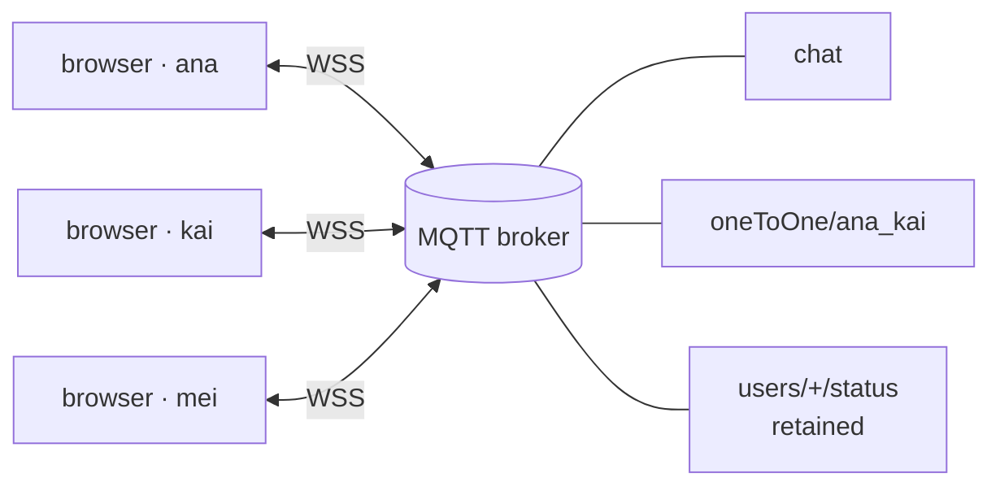

<p align="center">
  
</p>

<p align="center">
  <b>Real-time chat with no backend. The browser is the client; a broker is the wire.</b><br>
  <sub>Pick a username and talk. No account, no install, no server code, no database. Everything rides on MQTT over secure WebSockets.</sub>
</p>

<p align="center">
  <sub>
    <a href="#overview">OVERVIEW</a> &nbsp;·&nbsp;
    <a href="#quick-start">QUICK START</a> &nbsp;·&nbsp;
    <a href="#how-it-works-without-a-server">HOW IT WORKS</a> &nbsp;·&nbsp;
    <a href="#what-it-does">WHAT IT DOES</a> &nbsp;·&nbsp;
    <a href="#run-it">RUN IT</a> &nbsp;·&nbsp;
    <a href="#ship-it">SHIP IT</a>
  </sub>
</p>

<br>

<table>
  <tr>
    <td><sub>SERVER CODE</sub><br><b>None</b></td>
    <td><sub>DATABASE</sub><br><b>None</b></td>
    <td><sub>TRANSPORT</sub><br><b>MQTT over WSS</b></td>
    <td><sub>IDENTITY</sub><br><b>Your username</b></td>
    <td><sub>INSTALLABLE</sub><br><b>PWA</b></td>
  </tr>
</table>

## Overview

Echo is a chat app that needs no backend at all. Pick a username and start talking: a group room, direct messages, voice notes, files and reactions, with no account and no server of its own.

> [!NOTE]
> The broker only routes. Reactions, edits, deletes and presence are all messages, so every browser converges on the same conversation with nothing in the middle keeping state.

## Quick start

```bash
npm install
cp .env.example .env      # your MQTT broker's WebSocket URL
npm run dev               # http://localhost:5173
```

## Architecture




## How it works without a server

Every client connects straight to a shared MQTT broker over TLS WebSockets and talks in topics. The broker routes; the browsers do everything else.

| Topic | Carries |
|---|---|
| `chat` | the general room |
| `oneToOne/<userA>_<userB>` | a direct conversation, one topic per pair |
| `users/<username>/status` | presence, as a **retained** message, so newcomers see who is already here |
| `<topic>/__typing` | ephemeral typing indicators |

Reactions, pins, replies, edits and deletes are messages too, broadcast to every peer, so every client converges on the same conversation without anything in the middle keeping state.

```
Browser ── React (Vite)
            ├─ MqttContext ───── WSS (TLS) ─────►  MQTT broker
            ├─ ChatPage    all UI state and message handling
            └─ ToastContext
```

## What it does

<table>
  <tr>
    <td width="33%" valign="top"><b>Talk</b><br><sub>A general room and unlimited direct chats. Markdown, @mentions, slash commands, link preview cards, replies, edits, deletes, reactions and pins.</sub></td>
    <td width="33%" valign="top"><b>Share</b><br><sub>Voice notes, GIFs, an image lightbox, drag-and-drop files up to 10 MB, and a location on OpenStreetMap.</sub></td>
    <td width="33%" valign="top"><b>Disappear</b><br><sub>Disappearing messages and view-once images. Join and leave notices. Per-chat mute, sounds and OS notifications.</sub></td>
  </tr>
</table>

Dark and light themes, responsive down to a phone with iOS safe areas, and installable to the home screen.

## Run it

```bash
git clone https://github.com/kelyonn/echo.git && cd echo
npm install
cp .env.example .env     # your broker's WebSocket URL and credentials
npm run dev              # http://localhost:5173
```

```
VITE_MQTT_BROKER_URL=wss://your-broker:8884/mqtt
VITE_MQTT_USERNAME=...
VITE_MQTT_PASSWORD=...
VITE_LINKPREVIEW_API_KEY=     # optional, for link cards
```

The HiveMQ Cloud free tier works as is: use its WebSocket endpoint, port 8884, path `/mqtt`.

## Ship it

```bash
npm run build      # static files in dist/
```

Any static host will do. Serve it over HTTPS, which the PWA and browser notifications require.

| Command | |
|---|---|
| `npm test` | unit tests (Vitest) |
| `npm run lint` | ESLint |
| `npm run format` | Prettier check |
